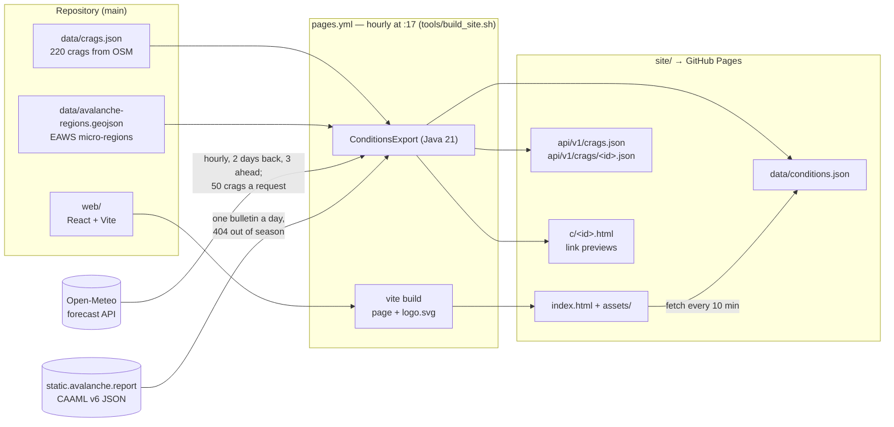
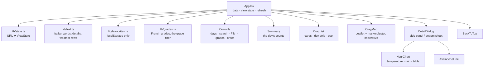

# Architecture

How cragcast is put together: the parts, how data moves between them, the contracts they keep,
and where each is tested. For *why* it is built this way, see the
[Architectural Decision Records](adr/README.md); for how to run it, the [README](../README.md).

## In one paragraph

Every hour a GitHub Action runs the Java scorer over the crags in `data/crags.json`: it fetches
each crag's forecast from Open-Meteo and the day's avalanche bulletin, turns weather and wall
aspect into a verdict for today, tomorrow and the day after, and writes static files — the
page's data, a versioned API, one share page per crag. GitHub Pages serves them next to a React
page built from `web/`. There is no server and no database in production
([ADR 0002](adr/0002-serverless-on-github-pages.md)); the crag list comes from OpenStreetMap
through a reviewed monthly PR ([ADR 0003](adr/0003-crags-from-openstreetmap.md)).

## The hourly run

1. **Build the page.** `tools/build_site.sh` runs `npm ci && npm run build` in `web/`; Vite empties
   `site/` and writes the page, its hashed assets, the PWA files from `web/public/` and the logo
   from `assets/logo.svg`.
2. **Score.** `ConditionsExport.run(args, env)` reads the crags and the avalanche regions, asks
   Open-Meteo for every crag (`OpenMeteoClient`, 50 places a request), reduces each forecast to a
   day (`WeatherReducer`: rain in the 48 h before, and rain, maximum temperature and wind from
   08:00 to 18:00), and scores it (`ConditionsScorer`: weather × aspect → GO / MAYBE / NO_GO with
   reasons). An unmapped aspect is scored as a shaded wall
   ([ADR 0004](adr/0004-unmapped-aspect-is-shaded.md)).
3. **Add the bulletin.** `AvalancheBulletins` fetches the day's file for Lombardy and
   `AvalancheRegions` places each crag in a micro-region; a crag inside one gets the danger level,
   bands and problems. It never changes the verdict, and a missing bulletin never fails the run
   ([ADR 0007](adr/0007-avalanche-bulletin-informs.md)).
4. **Write.** `site/data/conditions.json` (what the page reads), `site/api/v1/`
   ([ADR 0005](adr/0005-static-api-v1.md)) and `site/c/<id>.html` from `SharePages`
   ([ADR 0010](adr/0010-link-previews-as-static-pages.md)); `og.png` is copied from
   `assets/social-preview.png`.
5. **Publish.** The workflow uploads `site/` and deploys it to GitHub Pages.

## The parts

| Part | Where | What it does |
|---|---|---|
| Scorer and export | `backend/src/main/java/…/conditions`, `weather`, `export`, `avalanche` | the verdict, the weather reduction, the hourly export, the bulletin, the share pages; plain Java, no Spring needed at run time |
| Spring service | `backend/…/crag`, `weather/WeatherRefresh`, `*Controller` | the same scorer behind a REST API with PostgreSQL (Flyway); image on GHCR (`image.yml`, linux/arm64), run on a Raspberry Pi's home network only ([ADR 0015](adr/0015-raspberry-pi-pulls-its-stack.md)) |
| History copy | `backend/…/history` | `HistorySync` reads the `history` branch's CSVs from GitHub into `crag_history` (Flyway V4) at startup and each night, a day replaced whole; the CSV stays the source ([ADR 0016](adr/0016-history-copied-into-postgres.md)) |
| Calibration | `backend/…/calibration` | replays first-hand observed days (`data/observations.csv`) against Open-Meteo's Historical Forecast API, to tune the scorer's thresholds |
| The page | `web/src` | React 19 + TypeScript; reads `data/conditions.json`, keeps the view in the URL |
| Data tools | `tools/*.py` | `osm_crags.py` (the crag list from OSM, sectors folded — [ADR 0009](adr/0009-sport-climbing-crags-and-sectors.md)), `crags_diff.py`, `history_append.py`, `aspects_todo.py`, `avalanche_regions.py` |
| The Pi's page | `export/SiteData`, `SiteController`, `web/Dockerfile`, `web/nginx.conf` | the same page on the Pi: nginx serves the Vite build and hands `data/`, `api/v1/` and `c/` to the backend, which builds them with `ConditionsExport.build()` from the forecasts its hourly refresh fetched — no second Open-Meteo request ([ADR 0018](adr/0018-the-pi-serves-the-page-from-its-backend.md)) |
| Raspberry Pi stack | `deploy/pi/compose.yml` | the Spring service, PostgreSQL, the page and (CG-109) a nightly backup onto a USB disk ([`docs/pi-backup.md`](pi-backup.md)) as a Portainer Git stack: Portainer polls main and re-pulls the GHCR image; no runner, no inbound port; the home network and the owner's tailnet ([ADR 0017](adr/0017-the-pi-over-tailscale.md)), PostgreSQL on the Pi's localhost only |
| Infrastructure *(parked)* | `infra/oci`, `deploy/k8s` | Terraform for the Oracle VM and k3s manifests; kept, not applied |

### Inside the page

- **State.** The view — day, search, verdicts, province, grades, order, area, open crag, map or
  list — lives in the URL (`?q=&v=&p=&g=&o=&a=&crag=&show=&day=`), so a link opens the same view
  and back works. Ordering by distance stays in memory, with the position (CG-61). The
  reader's position and favourites never leave the browser
  ([ADR 0011](adr/0011-the-reader-stays-in-the-browser.md)).
- **The map.** Leaflet is driven imperatively inside `CragMap`; OSM text reaches the DOM as text
  only. The page's own moves (flying to a crag) are told apart from the reader's, so only a drag
  or a zoom offers "Cerca in quest'area".
- **Widths.** Below 600 px the filters fold behind "Filtri" and the map and the list show one at
  a time, the list first; from 900 px the panel takes the list's column; a card tightens when the
  *list* is under 460 px (a container query) ([ADR 0013](adr/0013-phone-first-layout.md)).
- **Chunks.** The page's own code, React, and Leaflet with markercluster are separate chunks; the
  crag's panel and its charts come in a fourth, fetched when the browser is idle or at the first
  "Dettagli" (CG-64).
- **Live and offline.** The page fetches the data every 10 minutes and on return to the tab; a
  network-first service worker (`web/public/sw.js`) serves the last copy offline, never caching
  map tiles; the footer says how old the data is and warns after 3 hours.
- **Design tokens.** Colours, spacing, type, radii and the focus ring are CSS variables at the top
  of `style.css`; the light theme redefines the colours only (CG-60, CG-62).
- **Accessibility.** No verdict by colour alone — shape, letter and words
  ([ADR 0014](adr/0014-never-by-colour-alone.md)).
- **Themes.** Dark, or light when the system asks (CG-60): one set of colour tokens in
  `style.css`, redefined for light; the axe scan and the snapshots cover both.

## Contracts

| Contract | Shape defined in | Rule |
|---|---|---|
| `data/crags.json` | `tools/osm_crags.py`; read by `ConditionsExport.Crag`, `CragImporter` and `SectorImporter` | ids (`osm-<type>-<id>`) are stable; changed only by a reviewed PR; `sectors` lists the OSM ids folded in as sectors (CG-104), each one in `osm-climbing.json` |
| `data/osm-climbing.json` | `tools/osm_crags.py` (`osm_object()`); read by `OsmObjectImporter` into `osm_object` (Flyway V5) | every object of the OSM query with its category; the table is replaced whole at startup, the file is the source (CG-103); with `crags.json`'s `sectors`, also into `sector` (Flyway V6, CG-104) |
| `data/conditions.json` | `ConditionsExport.Output`; typed in `web/src/types.ts` | the page's input; Java and TypeScript change together |
| `/api/v1/` | `ConditionsExport.api()` | fields only added, never renamed or removed; a break goes to `/api/v2/` |
| History CSV | `tools/history_append.py` (`FIELDS`) | on the `history` branch, one file per month; columns only added at the end ([ADR 0006](adr/0006-history-on-its-own-branch.md)); read by name by `HistoryCsv` |
| Share pages | `SharePages` | the day written as a date; reason words kept equal to `web/src/lib/text.ts` |

## Workflows

| Workflow | When | Does |
|---|---|---|
| `pages.yml` | hourly at :17, and on push to main touching the page, data or scorer | builds `site/` and deploys it |
| `uptime.yml` | hourly at :47 | checkfleet on the page, data, API and TLS; fails when the data is over 150 minutes old |
| `history.yml` | daily at 20:30 UTC | appends the day's verdicts to the `history` branch |
| `crags-refresh.yml` | the 1st of the month, 05:23 UTC | rebuilds `data/crags.json`, `data/osm-climbing.json` and `docs/aspects-todo.md` from OSM; opens a PR when either data file changed |
| `ci.yml` | every push to main and every PR | the jobs below |
| `lighthouse.yml` | PRs touching the page, data or scorer | Lighthouse budgets on the built page with real data |
| `image.yml` | push to main touching the backend, the page or the data they ship | the linux/arm64 images of the Spring service and (CG-110) the page with nginx, to GHCR |
| `release.yml` | by hand, from main | names the release `vYYYY.MM.DD`, builds both arm64 images with that tag and version inside, then publishes the GitHub Release with notes from the merged PRs ([ADR 0020](adr/0020-calendar-releases-the-pi-follows.md)) |
| `backlog-issues.yml` | push to main touching `BACKLOG.md` | GitHub issues and milestones follow the backlog |

## Tests

| Level | Tools | Covers | Floor |
|---|---|---|---|
| Unit | JUnit 5 + AssertJ, Vitest + Testing Library, `unittest` | scorer, reducer, clients, text, state, components, every tool | — |
| Integration | `*IT` under failsafe, `FakeHttp`; a fake Overpass | the export and the calibration run whole against fake servers; Testcontainers against PostgreSQL in CI | — |
| End to end | Playwright (Chromium; desktop and Pixel 7), axe | flows jsdom cannot do: dragging the map, layout per width, swipes, accessibility | — |
| Visual | Playwright snapshots, CI's own images | seven views on fixed data; a layout change fails with its diff | 25 px |
| Coverage | JaCoCo, Vitest v8, coverage.py | measured in CI, floors only go up ([ADR 0012](adr/0012-tests-floors-only-go-up.md)) | backend 93%, page 99%, tools 97% of lines |
| Plumbing | actionlint, shellcheck, `backlogsync check`, `terraform validate` | workflows, scripts, the backlog, the parked Terraform | — |

CI's jobs: `backend`, `web`, `e2e`, `tools`, `lint`, `terraform`, `backlog`; Lighthouse runs as
its own workflow.

## Where things are written down

- [`README.md`](../README.md) — what cragcast does, the API, running it locally.
- [`CLAUDE.md`](../CLAUDE.md) — the rules for working in the repository.
- [`docs/adr/`](adr/README.md) — why each decision was taken.
- [`BACKLOG.md`](../BACKLOG.md) — planned work by milestone (`CG-n`); [`ROADMAP.md`](../ROADMAP.md) is generated from it.
- [`docs/aspects-todo.md`](aspects-todo.md) — the crags whose wall aspect is still to map on OSM.
- This file — how the parts fit; update it when a part, a contract or a workflow changes.
